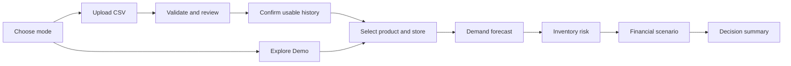

# MarginGuard 企业 CSV 数据上传技术方案

日期：2026-10-28（Australia/Sydney）  
状态：**待确认的设计文档，尚未实施上传功能。**  
项目：MarginGuard — Retail Risk & Financial Decision Intelligence

## 1. 推荐方案与首版边界

在现有 My Business 工作空间内增加两种模式，共用四个业务页面和现有 Python 引擎：

- **Explore Demo**：继续使用 Walmart M5，保留当前数值、来源说明和明确标注的演示假设。
- **Analyse My Business**：用户上传自己有权使用的每日销量 CSV，通过校验后分析所选商品和门店。标注 `User-uploaded data · source not independently verified`，不能将通过格式校验等同于已核实真实企业交易。

Market Intelligence 保持独立，继续使用 ABS；不自动把企业销量与 ABS 比较，也不使用 ABS 调整预测。

推荐首版采用：**每日汇总 CSV + 独立上传适配层 + 匿名浏览器会话 + 短期私有存储 + 既有四页复用**。不建设注册登录、多租户后台、长期账本、交易明细 ETL、异步任务平台或另一套 Dashboard。

首版应明确以下范围：

| 项目 | 首版决定 |
|---|---|
| 数据粒度 | 每个商品—门店—自然日最多一行，按件销售，整数非负销量 |
| 文件格式 | UTF-8 / UTF-8 BOM、逗号分隔 CSV；不接受 Excel、ZIP 或远程文件 URL |
| 历史缺口 | 默认未知，不自动补零；可显式选用一个连续且有记录的分析区间 |
| 重复记录 | 阻止导入，要求在源系统整理；不猜测是重复导出还是多笔交易 |
| 退货 | 不混入 Units Sold；负销量拒绝，退货预测与净销量模型后续另做 |
| 财务币种 | 当前完整财务链路仅 USD；非 USD 可做需求/库存分析，财务入口明确不可用 |
| 企业假设 | 手工确认，不沿用 M5 的库存、成本或预算默认值 |
| 保存方式 | 临时会话数据，提供删除按钮、服务端过期检查和定时清理；不提供永久分享链接 |
| 跨页参数 | 首版传递数据集和系列身份；库存/财务输入仍逐页确认，方案 B 的自动草稿贯通不隐含在上传开发中 |

**币种是当前真实的兼容性限制。** 若希望首版直接支持澳大利亚企业的 AUD 财务分析，应先追加一个明确批准的币种契约改造：统一输入、结果元数据、表格、图表和测试中的币种，不换汇、不改财务公式；不能仅把 USD 字样替换为 AUD。该扩展单独估算，不能声称现有引擎已经支持任意币种。

## 2. 已检查的现有架构

以下是本次读取项目代码后确认的事实，与后续建议分开列出。

| 现有文件/接口 | 当前行为 | 上传功能的接入点 |
|---|---|---|
| `app.py:create_app(data_dir=None)` | 固定 `DATA_DIR`，从 `processed_sales.csv` 和 `scenario_defaults.json` 读取 Demo；全局请求上限为 32 KiB | 新增独立上传 Blueprint 和私有数据服务；不能按请求修改 `DATA_DIR` |
| `data_loader.py:load_series(path)` | M5 专用七列格式；整数销量；各系列至少 120 个连续日；分类必须一致 | 保留原样，不将用户 CSV 覆写成 M5 文件 |
| `forecast.py:validate_history()` | 非负有限销量、日期排序、唯一且逐日连续 | 上传适配层先校验，再传入标准记录 |
| `forecast.py:analyse(rows)` | 至少 42 天：前段训练，最后 14 天回测；按 MAE 选择两方法，再用全部历史预测未来 14 天 | 原样复用，无需改预测公式 |
| `inventory.py:inventory_risk()` | 接收恰好 14 个每日预测值及库存假设 | 复用，只更换合法的预测来源 |
| `scenario.py:compare_strategies()` | Wait / Reorder / Discount，采购约束、FIFO 成本层和最高可行毛利润推荐 | 复用，继续调用 `finance.py` |
| `phase2_inputs.py` | 需求有限非负；物理库存、采购数量等为整数；每日需求上限 1,000,000 | 上传规则与这些范围对齐 |
| `finance.py`、`scenario.py` | 财务结果包含固定 `currency: USD` | 非 USD 财务必须阻止，或先批准币种扩展 |
| `static/js/main.js` | 金额格式与部分文案固定 USD；URL 只传 item/store；换页重置假设；有 AbortController 和请求代次保护 | 增加来源上下文和私有系列标识；保留旧响应防护 |
| `/api/analysis` | 除选定系列外，还重算全部 Demo 系列的概览 | 上传模式按需计算选定系列，不能照搬为每次计算全部企业商品 |
| `market_api.py` / `market_service.py` | 独立 ABS Blueprint 和公共快照缓存 | 保持不变，不存放用户数据 |
| `tests/test_product_navigation.py` | 验证恰好五条非 API 页面路由 | 上传流程放在首页内，无需新增 `/upload` 页面 |
| `.gitignore`、旧打包脚本 | 排除了现有 raw、部分处理文件和 `.runtime`，但不是任意企业文件的完整防泄漏边界 | 私有存储放仓库外，并新增针对上传数据的打包/忽略验收 |

当前业务页面为 `/`、`/forecasting`、`/inventory`、`/scenarios`，市场页面为 `/market`。本方案全部保留。

## 3. 用户操作流程



### 3.1 上传与确认

1. 默认入口仍可直接 Explore Demo。Analyse My Business 在同一首页展开上传面板，不改变 ABS 工作空间。
2. 上传前展示模板、大小/行数限制、临时保存期限、删除方式，以及不要上传客户姓名、联系方式、支付记录等字段的提示。用户声明有权使用数据。
3. 用户声明销量为每日正向售出数量、选择经营日时区、金额币种与税费口径。CSV 只有日期，不做自动时区转换；时区用于判断完整营业日和数据新鲜度。
4. 文件在服务器校验。显示总行数、商品/门店/组合数、日期范围、重复数、未知销量、缺失日、可预测系列数以及价格/成本覆盖率。预览仅返回给当前会话，最多 20 行。
5. 用户审核具体可用区间，确认后生成不可变的数据集版本。存在结构错误时不能确认；某些系列历史不足时，可在报告中保留并禁用其预测入口。
6. 进入四个既有业务页面。页头持续展示上传身份、币种、分析截止日、未来 14 天日期和质量提示，清除所有 M5 固定商品数量及默认企业假设文案。

### 3.2 从销量到采购建议

- **Demand Forecast**：同一时间顺序回测和两方法 MAE；未来预测与历史回测分开。
- **Inventory Risk**：用户输入对应分析起点的库存、交货期、安全库存及在途量。未填写前显示 `Not assessed`，不自动给出真实库存风险结论。
- **Financial Scenario**：用户确认 USD 金额、旧库存成本、新采购成本、价格、采购量、费用、MOQ、预算和折扣假设。缺失必需输入时不生成利润或推荐。
- **Decision Summary**：复用现有推荐结果，并集中列出数据集版本、商品/门店、预测区间、本次手工假设、现金支出、未满足需求、可行性、推荐原因和权衡。建议只针对测试的三个策略和指定采购数量，不是所有采购量的全局最优解，不提交真实订单。

首版跨页只保留来源、数据集和商品选择。库存页到财务页必须重新审核库存等参数，明确显示未自动带入。以后实施方案 B 时应复用同一上下文定义，避免分别建设 Demo 草稿和上传草稿。

### 3.3 时间对应关系

预测始终从所选历史截止日的次日开始。例如历史截至 2026-10-20，预测期就是 10 月 21 日至 11 月 3 日，不自动从今天开始。初版优先使用完整日数据，默认最后允许日期为所选经营时区的昨日；当日或未来行要求用户重新导出已完成日，不能静默删除。

库存表单增加 `Stock as of` 或明确的 `Hypothetical stock at forecast origin` 确认。10 月 28 日的实际库存不能直接冒充 10 月 20 日收盘库存。时间不匹配时要求用户提供对应时点库存，或明确转为该历史起点的假设情景。

## 4. CSV 模板与字段语义

推荐公开模板标题如下；四个必填列始终存在，可选列可省略：

```csv
Date,Product,Store,Units Sold,Unit Price,Unit Cost
2026-07-01,SKU_001,STORE_A,12,4.50,2.10
2026-07-02,SKU_001,STORE_A,0,,
2026-07-03,SKU_001,STORE_A,9,4.50,2.10
```

**以上仅为人工编写的格式示例，不是真实企业交易，也不够进行预测。** 正式数据需要连续历史。将来用于测试的完整 CSV 也必须标注为合成夹具。

| 列 | 要求 | 语义与处理 |
|---|---|---|
| Date | 必须有值，严格 `YYYY-MM-DD` | 商品—门店当地自然日；拒绝混合日期格式、带时间戳和歧义日期 |
| Product | 必须有值，最长 80 个字符 | 商品标识按字符串保存，保留前导零和大小写；不根据名称猜测分类 |
| Store | 必须有值，最长 80 个字符 | 门店标识；单店也需要明确标识，不自动合并门店 |
| Units Sold | 必须有此列 | 正向售出件数，0–1,000,000 的整数；空白表示未知，不能进入模型；非数字、负数、小数拒绝 |
| Unit Price | 可省略/可空 | 该历史日每件实际销售单价或已正确加权的平均单价；非负有限十进制，不含货币符号 |
| Unit Cost | 可省略/可空 | 该日单位成本参考，需声明成本含义；不会自动等同于现有库存或新采购成本 |

金额上限与现有校验一致，单值不超过 1,000,000,000；空白保持 `null`，合法的 0 保持 0。初版允许最多 6 位小数，输入和财务金额使用 Decimal；不在导入时统一四舍五入到两位。

表头可以做有限、可预测的标准化：去 BOM、去首尾空格、不区分英文大小写，并接受文档列出的 `units_sold`、`unit_price`、`unit_cost` 别名。出现两个表头映射到同一字段时拒绝。初版不做任意列映射，不接受额外客户、订单或地址字段；返回明确的允许字段列表。商品/门店首尾空格的清理必须在预览中报告，清理后发生同键冲突仍按重复错误处理。

文件级元数据通过上传表单提交，不在每个销售日重复：币种、经营时区、税费口径、销量含义、成本含义及使用授权声明。若币种未知，仍可进入销量/库存分析，但财务功能关闭；不猜测美元符号代表哪个币种。

## 5. 数据验证规则

### 5.1 文件级与结构级

使用 Python 标准库 `csv` 严格解析，日期用 `datetime`，金额用 `decimal`；无需为首版上传新增 Pandas 依赖。扩展名和 MIME 都不能单独证明格式正确。拒绝二进制内容、NUL、损坏编码、超长字段、引号未闭合、列数不一致、重复表头及仅有表头的文件。完全空白行可跳过，但记录数量；不静默忽略内容错误行。CSV 解析必须支持合法的引号、CRLF/LF 和 BOM。

任何格式/数值硬错误先阻止该批确认，不以“删除坏行后剩下的也能算”为成功。报告最多返回前 50 个错误的位置、字段和错误码，另给总数，避免返回整个原始文件。空白销量和缺日属于已识别的未知值，可保留在审计中，但不传给预测引擎。

### 5.2 重复、缺日与零销量

| 情形 | 首版规则 |
|---|---|
| 完全相同的重复行 | 标记重复键并阻止确认；不能断言是重复导出还是两笔真实记录 |
| 同日、同商品、同门店但销量不同 | 同样阻止；不自动求和、平均或取最后一行 |
| 同日同商品但不同门店 | 不重复，各自形成系列 |
| 一天没有记录 | 未知销量，不能当零销量 |
| 有记录且 Units Sold = 0 | 用户明确提供的零销量，保留为有效观察 |
| 有日期但 Units Sold 空白 | 未知，不是零；可用区间在此处断开 |
| 未知价格或成本 | 保留空值，不影响纯销量预测；对应财务参考缺失 |
| 序列开始/结束之外没有记录 | 不为其构造零销量；不能假设商品当时已上架或仍在销售 |

初版不提供一键补零、插值或前向填充。用户可以重新导出含明确零销量的完整每日表，也可选择一个有真实记录的连续区间。日后若支持“完整交易抽取中无交易日=0”，必须先收集每个系列的营业/上架覆盖范围和用户声明，保存补零来源标签；本版本不实现该推断。

### 5.3 有效历史与筛选报告

按商品—门店计算以下审计指标，不只报告 CSV 行数：

- 首末记录日期、日历跨度、唯一记录日期数、已知销量日期数、显式零销量日、非零销量日。
- 缺行日数、空白销量日数、最长连续已知区间，以及最后一个已知日期之前的连续尾段。
- `未知日比例 = (缺行日数 + 空白销量日数) / 日历跨度天数`。重复键须先处理，不能用重复行膨胀覆盖率。
- 用户选定区间的开始/结束、连续天数、排除的旧记录/未知日数量及有效训练/回测长度。
- 价格/成本有值比例，以及最后一个非空参考值和其实际日期；不能将旧价格标注为最新销售日价格。

至少 **42 个连续已知日**才能调用现有完整分析：28 天训练 + 14 天验证。42–83 天显示短历史提示；建议 84 天以上，120 天以上可作为更充分的演示样本。84/120 天是产品质量建议，不是模型可靠性的统计保证，也不改变 M5 加载器原有 120 天门槛。

有缺口时，默认建议截至最后已知日的连续尾段；长度不足 42 天则禁用完整预测。用户可显式选择更早的合格连续区间，但必须显示这是截至较早日期的历史模拟，并报告排除范围，不能偷偷改成“未来两周实时需求”。每个范围选择在确认时固定为数据集版本的一部分，不能反复挑选 MAE 最好看的区间作为自动筛选依据。

全零连续历史在数学上可以产生零预测和 MAE=0，但显示“没有正销量证据”，不能称高准确率。销量很稀疏时显示实际零销量比例、非零天数和均值，不凭空设定可信度分数。没有库存可售性字段时，观察销售可能受缺货限制；本产品不自动还原潜在未满足需求。

### 5.4 退货、负销量与时间泄漏

`Units Sold` 首版定义为正向售出数量，不是销量减退货后的净销量。负数直接拒绝，提示从源系统分别导出售出量和退货量；不取绝对值、不截为 0，也不删除退款记录后称其为净销量分析。即使净销量为正，程序也无法仅凭数值判断其语义，必须要求用户声明。

现有预测逻辑仅使用过去销量，保持以下边界：回测预测只使用回测前训练期；方法选择使用最后 14 天的 MAE；未来预测才使用全部已选历史。由于同一个验证窗口用于选方法，该 MAE 是模型选择用的验证成绩，不是额外独立测试集的无偏成绩。日后增加独立/滚动评估须另行批准，不在上传层偷偷改公式。

历史价格/成本只供情景参考，不参与销量预测或回填训练值；未来行、未完成当日记录以及完整区间之外的数据不能作为当前分析输入。系统不接受浏览器提交的“预测值”作为库存/财务权威输入，后端自行取得本数据集的分析结果。

## 6. 库存与财务参数设计

建议不把库存、MOQ、预算等加入首版每日销量 CSV。它们是某时点的快照或未来业务假设，重复写入每日行容易产生冲突。

| 参数 | 输入方式与约束 |
|---|---|
| Current Stock | 页面填写，整数 0–1,000,000；注明截至日期或模拟起点假设 |
| Supplier Lead Time | 页面填写 0–365 的整数天；不从销售记录推断 |
| Safety Stock | 页面明确填写，允许 0；不是从数据自动估计 |
| On-order Units | 库存页面填写；到货日期未知的处理继续使用原模块规则 |
| Excess Cover Threshold | 沿用现有可解释阈值，必须标为用户设定，不称行业标准 |
| MOQ、Order Quantity | 手工整数；正订单受 MOQ 约束，0 采购遵循原费用规则 |
| Procurement Budget | 用户确认的本次新增采购现金预算，不是自动识别的银行余额 |
| Selling Price | 手输，或用户点击引用带日期的 Unit Price 参考；引用后仍是未来售价假设 |
| Existing Inventory Cost | 当前库存账面单位成本，必须单独确认 |
| Unit Purchase Cost | 新采购报价，不能自动使用同一个历史 Unit Cost 替代 |
| Freight / Other Costs | 新订单费用，继续计入新货单位到手成本与采购现金 |
| Discount / Demand Uplift | 手工情景参数，不称为已估计价格弹性 |
| Maximum Unmet Demand | 可选服务约束，与安全库存分开 |

上传模式未知输入显示空白。没有库存参数时首页风险显示 `Not assessed`；没有成本时财务结果显示 `Required assumptions missing`，不从 `scenario_defaults.json` 借用 200 件库存、成本等演示值。用户明确输入的 0 与缺失不同。

库存与财务两个接口都独立校验 `stock_as_of` 或 `hypothetical_stock_at_origin`，不能因为用户曾访问库存页就假设财务页的新输入时点一致。适配层另附输入来源元数据，区分“用户报告的库存快照”“用户确认的历史参考”和“未来情景假设”；这些来源均未独立核实。原库存模块的假设说明字符串保持不变，不通过改公式或隐藏原说明将输入包装为已验证企业事实。

继续保留旧库存成本、新采购到手成本、COGS 和采购现金之间的区别。采购现金不是当期全部销售成本。金额采用同一声明的税费口径，建议不含销售税；系统不做税务核算、汇率转换或混合币种分析。

现有情景模型交货期 7 天意味着第 8 天才可售；交货期大于等于 14 天，订单本期不产生销售但仍计采购现金。已有在途订单的收货和成本层目前不受情景引擎支持：`on_order_units > 0` 时不得声称财务页完整评估了原库存情境。可另建明确“不含既有在途”的手工情景，不将其无声加到当前库存，也不自动带入库存建议采购量。

## 7. 后端结构与接口

### 7.1 模块边界

```text
CSV stream
  → business_csv.py        严格解析、数据质量报告、连续区间
  → business_store.py      会话归属、临时记录、版本、配额和删除
  → business_service.py    授权后选系列、适配记录、调用原引擎
  → business_api.py        Flask Blueprint、参数校验、错误响应
  → 原有四业务页           交互、来源提示、SVG 展示
```

使用标准库 `csv / datetime / decimal / secrets / sqlite3 / pathlib`。CSV 校验和数值计算在 Python 完成；前端不重写预测、MAE、库存或财务逻辑。

规范元数据至少包含：`dataset_id`、不可变 `revision`、服务端所有者标识、上传/过期时间、`source_kind=user_csv`、币种/时区/税费/销量语义、校验器版本、确认的区间和用户声明。每个组合获得随机 `series_id`，原商品/门店名称保存在授权后的元数据中。

模型输入只需要以下形状；这是结构说明，不是本轮实现代码：

```python
rows = [{"date": python_date, "units_sold": nonnegative_integer}, ...]
analysis = forecast.analyse(rows)
daily_demand = [row["prediction"] for row in analysis["future"]]
```

价格、成本、来源、缺日审计保存在旁边，不增加虚假的 M5 分类。页面原类别列可以显示 `Not supplied` 或隐藏。缺失单位价格不妨碍模型使用销量。

### 7.2 建议 API 契约

既有 `/api/catalog`、`/api/analysis`、`/api/inventory`、`/api/scenarios` 默认继续服务 M5，保持响应与数值兼容。新增接口使用 `/api/business/`，不接收本地文件路径或远程下载地址。

| 方法与路径 | 输入 | 输出/行为 |
|---|---|---|
| `GET /api/business/session` | 无业务明细 | 初始化/恢复匿名会话，返回 CSRF token、到期时间、上传限制与模式能力 |
| `POST /api/business/uploads` | multipart：一个 CSV、币种、时区及小型声明字段 | 同步校验；201 返回临时 upload_id、报告、少量预览和报告版本，不自动启用数据 |
| `POST /api/business/uploads/<upload_id>/confirm` | 报告版本、允许的 series/range 选择、确认声明 | 再次核对归属和范围；201 返回 dataset_id、revision 及可分析目录；原子提交 |
| `DELETE /api/business/uploads/<upload_id>` | CSRF token | 取消待确认文件，204 |
| `GET /api/business/datasets/<dataset_id>/catalog` | 可选有界分页 | 返回当前会话的商品/门店目录、opaque series_id、资格及质量摘要 |
| `GET /api/business/datasets/<dataset_id>/analysis` | series_id、revision | 选定系列的历史、现有 analyse 输出、参考价格/成本及数据身份；未知假设返回空值 |
| `POST /api/business/datasets/<dataset_id>/inventory` | series_id、revision、当前库存日期和原库存输入 | 服务端加载对应预测，返回原模块结果及上下文 |
| `POST /api/business/datasets/<dataset_id>/scenarios` | series_id、revision、stock_as_of 或 hypothetical_stock_at_origin、原情景输入与必要声明 | USD/时点/输入检查通过后调用原引擎，返回结果和假设快照 |
| `DELETE /api/business/datasets/<dataset_id>` | CSRF token | 删除该会话的数据和派生结果，204；旧页面失效 |
| `DELETE /api/business/session` | CSRF token | 清除当前匿名会话全部待确认/已确认数据，注销 cookie |

选择产品和门店时先由目录获得内部 `series_id`，后端始终通过归属检查后的索引解析。客户端不能通过改变 Product/Store 字符串读取其他数据集。

确认操作采用 revision 和状态检查：重复确认不得生成多份数据；过期报告、修改后的范围和旧版本返回明确冲突。失败不能覆盖上一个可用数据集。首版每会话保留一个已确认数据集和一个待确认上传；确认替换时先提示旧分析将失效，再原子激活新版本并删除旧版本。

### 7.3 错误与前端一致性

统一返回结构如 `{error:{code,message,fields},request_id}`，不包含服务器绝对路径、原始文件内容或栈追踪。状态约定：400 参数错误；401 会话无效；403 CSRF/来源不合法；404 不存在或不属于当前会话；409 版本/确认状态冲突；410 当前所有者已知资源过期；413 超大小；415 不支持格式；422 内容校验或历史不合格；429 超配额；503 暂时处理超时/资源不可用。

每个结果带 `source_kind + dataset_id + revision + series_id + forecast_origin`。私有缓存键还包含所有者和预处理/算法版本；不同用户同名 SKU 不能命中同一个缓存。前端切换来源或系列时立即清空旧图表/推荐、取消旧请求，并在应用结果前核对完整上下文。后端不得信任前端缓存或 cookie 中的业务金额。

在 URL 中，Demo 继续使用既有 item/store；上传模式使用 `mode=business&dataset=<opaque>&series=<opaque>`。私有商品名、门店名、库存、价格、预算不放 URL，dataset_id 本身也不是访问凭证。市场链接不携带企业数据参数。

## 8. 匿名会话、隔离与隐私

### 8.1 不登录也必须检查归属

采用 Flask 签名会话 cookie，仅放服务器生成的高熵随机所有者引用，不放 CSV、商品名称、金额或完整校验报告。签名 cookie 不是加密数据容器。服务端 SQLite 元数据表保存数据集归属、状态、到期和配额；每个业务 API 都先检查归属，再读规范文件。不能只凭随机 dataset_id 就放行。匿名会话可用于区分访客，但不等于经过认证的企业账户。[会话设计依据：OWASP Session Management](https://cheatsheetseries.owasp.org/cheatsheets/Session_Management_Cheat_Sheet.html)

推荐 32 字节随机会话引用、随机数据集/系列 ID、环境变量提供签名密钥；不接受客户端自选所有者、不通过 URL 传 session token。公开环境 cookie 为 `Secure + HttpOnly + SameSite=Lax`，host-only、不设置跨域 Domain。POST/DELETE，包括 multipart 上传，检查会话绑定的 CSRF token 和同源请求；SameSite 只是补充。不同源不启用携带凭据的 CORS。[Flask 安全说明](https://flask.palletsprojects.com/en/stable/web-security/)

同一浏览器配置中的标签页共享匿名身份，这是设计限制，不是假装多个企业账户。清除 cookie、会话过期或清除全部数据后不可恢复；不以设备指纹、IP 地址或原文件名恢复权限。共享电脑需要显式清除；关闭标签页不保证删除服务器数据。若将来需要长期敏感企业数据、跨设备恢复或团队共享，应另建身份认证与授权方案。

### 8.2 存储位置与内容

上传数据位于服务器配置的**仓库外私有临时根目录**，不在 `data/`、`static/`、`templates/`、`research/` 或打包目录内。路径由服务端随机 ID 构造；用户文件名只能用于有界、转义后的显示，绝不作为文件路径。使用原子写入和最小文件权限，禁止跟随指向根目录外的符号链接。

原始上传流不作为下载资源保存。若框架临时落盘，使用受控临时目录并在请求结束关闭/清理；应用只保留通过校验的规范记录、最少审计元数据和必要派生结果。SQLite 仅用于轻量元数据与配额，规范数据用私有 JSON/CSV 文件；不需要 SQLAlchemy。数据库、临时溢出文件、索引、缓存和数据库日志都必须纳入同一生命周期与备份排除范围。

文件类型验证、应用生成文件名、大小限制和 webroot 外存储属于分层控制，不能靠 `.csv` 后缀就声称安全。首版不开放上传文件下载/原文浏览路由，不执行 shell、eval、pickle 或上传脚本。[上传控制依据：OWASP File Upload](https://cheatsheetseries.owasp.org/cheatsheets/File_Upload_Cheat_Sheet.html)

表格和错误信息使用自动转义或 `textContent`。拒绝文本字段中的控制字符与公式式前缀 `= + - @`，明确这是严格模板的约束；数值列只能经数值解析。初版不提供企业 CSV 导出，后续导出还需单独处理电子表格公式注入，不能认为浏览器转义等于导出安全。

### 8.3 清理、日志与发布包

建议待确认上传 15 分钟到期；会话空闲 30 分钟到期且绝对最长 2 小时，读取不能无限延长绝对期限。每个请求先检查逻辑过期，过期后立刻不可访问；周期清理每 5 分钟运行，删除过期规范数据及全部派生缓存。正常情况下物理删除延迟不超过约 5 分钟，服务故障时不能承诺该时限，因此需监控清理任务并在服务启动时补清理。

支持立即删除、失败路径 finally 清理、崩溃孤儿文件扫描，以及到期/删除与读取并发的原子状态检查。临时目录不进服务器备份；存储介质的安全擦除不在首版承诺范围。公开部署前确认托管平台没有自动长期保留上传目录或请求正文。

日志仅记录事件类型、随机 request_id、状态、耗时、行数和错误码；不记录 CSV 行、商品/门店名、原文件名、金额、cookie、CSRF token 或私有响应。错误行号可返回给所有者，不写明细日志。反向代理/错误追踪也要关闭正文捕获、脱敏 cookie 和 query；生产调试模式关闭。

`.gitignore` 增加私有缓存/临时数据库兜底规则，同时在打包验收中检查上传根目录不可被收集。只使用人工合成夹具提交测试；不将用户实际 CSV、截图、校验报告或真实业务日志上传 GitHub。单靠 `.gitignore` 不能解决已跟踪文件或错误打包问题。

所有私有报告、目录、历史、预测和场景响应设置 `Cache-Control: no-store`；不使用 CDN 缓存、Service Worker 或浏览器持久存储保存企业记录。原有公共 ABS 缓存与它们隔离。`Referrer-Policy: no-referrer`、`nosniff`、限制 iframe 嵌入与本地资源 CSP 纳入公开版响应头验收；不接入会采集页面业务内容的第三方分析脚本。

## 9. 大小、处理时间与部署约束

下列为**建议的首版配置上限，需压测确认，不是当前已经实现的保障**：

| 项目 | 建议上限 |
|---|---|
| 单个原始 CSV | 5 MiB；multipart 总请求 6 MiB，流读取时再次计数 |
| 同次上传 | 1 个文件；multipart 部件最多 8；非文件字段最多 16 KiB |
| 数据量 | 50,000 条数据行、100 个商品—门店组合 |
| 字段/区间 | 单字段最多 1 KiB；单系列日历跨度最多 1,096 日；先检查跨度再展开日期 |
| 每会话 | 1 个已确认集 + 1 个待确认集；每个规范集最多 20 MiB |
| 全站临时空间 | 500 MiB 总上限；达到上限拒绝新上传，不删除仍有效的其他用户数据腾空间 |
| 上传频率 | 每会话 10 分钟 3 次；同时配合代理层访客/IP 总速率限制 |
| 计算频率 | 每会话每分钟 30 次，重复同版本分析可复用私有缓存 |
| 计算时间 | 解析校验目标 3 秒、上限 5 秒；单系列分析目标 1 秒、上限 5 秒；均待基准验证 |
| 公共服务保护 | 上传体读取/网络超时与计算超时分别配置；总处理上限暂定 15 秒；全站最多 2 个上传验证任务 |

当前 32 KiB 的小 JSON 请求限制应保留，只在上传路由解析请求前设置更高的请求级限制，并额外限制字段/部件。Flask 3.1 支持请求级资源限制；还需代理和 WSGI 层配合，不能只调一个全局 MAX_CONTENT_LENGTH。[Flask 资源限制与配置](https://flask.palletsprojects.com/en/stable/config/)

Flask 上传可能使用内存或临时文件，超限错误在开发服务器与生产服务器上的表现可能不同，验收应包括生产 WSGI 的 413 行为。[Flask Uploading Files](https://flask.palletsprojects.com/en/stable/patterns/fileuploads/)

程序内在解析循环检查行数、字节、跨度和 monotonic 时间；线程的等待超时不等于停止后台解析。公开版需要可终止的工作进程或托管运行时硬时限，并确保异常终止留下的文件可清理。小规模同步处理足够，不引入 Celery/Redis；如果这些上限仍无法满足资源隔离，再评估任务队列。

匿名会话无法可靠阻止访客清 cookie 重新申请配额，所以还需要跨会话的全局并发/磁盘限制及代理层限速。初版公开部署限制为单实例；如果使用多个 WSGI worker，元数据、配额和清理必须通过同一 SQLite/私有目录协调，不能用每个 worker 各自的全局字典充当所有权与配额。多副本部署另行设计。

当前 `app.run()` 只用于本机。真正公开访问需生产 WSGI、HTTPS、正确的代理配置、资源限额和生命周期验收；本方案没有执行部署。[Flask 部署要求](https://flask.palletsprojects.com/en/stable/deploying/)

## 10. 页面与文件修改计划

| 位置 | 计划改动 |
|---|---|
| `app.py` | 注册 business Blueprint、配置私有根目录/会话/限制；保持原 Demo 和 ABS 契约 |
| `business_csv.py`（新增） | 格式与字段验证、每日唯一性、连续性、审计和模型输入适配 |
| `business_store.py`（新增） | 临时元数据、所有权、revision、原子提交、缓存/配额/清理 |
| `business_service.py`（新增） | 数据源选择、原引擎调用、空假设/币种/时点限制、输出上下文 |
| `business_api.py`（新增） | 上传、确认、分析、库存、场景、删除和统一错误响应 |
| `scripts/cleanup_business_data.py`（新增） | 显式运行的清理入口，可供平台调度；不依赖浏览器关闭 |
| `templates/base.html` | My Business 模式切换、来源/币种/日期、过期/删除入口；保持两个工作空间 |
| `templates/dashboard.html` + `_business_upload.html`（新增片段） | 首页上传、报告、确认和目录；未知风险不显示默认企业 KPI |
| `templates/forecasting.html` | 用户历史质量、区间、已实现回测含义与预测日期提示 |
| `templates/inventory.html` | 库存时点说明、企业空白输入、下一步审核提醒 |
| `templates/scenarios.html` | 币种能力、成本参考日期、输入来源及 Decision Summary |
| `static/js/business_upload.js`（新增） | multipart 交互、进度/错误/确认/删除；不做权威统计 |
| `static/js/main.js` | 按模式调用对应 API、opaque 系列 URL、完整上下文防旧响应、缺失假设状态 |
| `static/css/style.css` | 复用当前卡片、表单、流程样式，增加有限上传/报告状态 |
| `tests/test_business_*.py`、合成夹具（新增） | 下节校验、隔离、集成和生命周期测试 |
| `.gitignore`、README、打包验收 | 排除私有数据、说明限制与运行/清理方式 |

`forecast.py`、`inventory.py`、`finance.py`、`scenario.py`、M5 `data_loader.py` 及 M5/ABS 数据无需修改。市场模板、市场 JavaScript 和市场 API 保持独立。若批准 AUD 财务扩展，其币种契约文件范围另行列出，不能夹带在上传适配中。

## 11. 测试计划与验收标准

既有 **141 项测试**为方案 A 已验收基线，本次设计没有新增可运行测试，也未重新执行该测试集。开发上传功能后必须全部保留并运行；新增测试不能用替换/删除旧测试换取通过。

| 测试组 | 必须覆盖 |
|---|---|
| CSV 结构 | 标准模板、BOM、CRLF、合法引号、空文件、仅表头、错误编码、缺列/额外列/重复列、超长字段、损坏引号、多文件 |
| 标识与数值 | 前导零、Unicode、首尾空格冲突、0/空值区分、负数、小数销量、NaN/Inf、数值上限、公式式文本、超长产品名 |
| 日期 | 闰日、排序、重复日期、缺日、空白销量、当日/未来日期、时区边界、超跨度、不自动填零 |
| 历史长度 | 27/28 天不能完整回测；41 天拒绝、42 天可分析；83/84 的提示；119/120 不改变 M5 独立门槛 |
| 特殊序列 | 全零、稀疏、多个门店、同 SKU 不同会话、部分系列不合格、早期连续区间必须显式确认 |
| 数值一致性 | 对相同规范 rows，上传 API 与直接 analyse/inventory_risk/compare_strategies 结果一致；两方法 MAE 和未来期分开 |
| 业务输入 | 未填库存不显示已评估风险；未填成本不产生利润；历史价需确认；旧/新成本分开；USD 放行，AUD/未知币种财务拒绝 |
| 库存边界 | 时点错配、在途量提示、7 天交货不能提前销售、超过 14 天、0 采购、MOQ/预算不可行、无可行策略 |
| 权限 | 两个独立 test_client；甲能读/删自己的数据，乙即使知道完整 ID 也不能访问；伪造 cookie、无 cookie、过期 session、路径穿越 |
| CSRF/浏览器 | multipart 无 token、错误 token、跨源请求被拒；未登录不等于无鉴权；私有响应 no-store，无跨源凭据放行 |
| 生命周期 | 确认失败保留旧集、重复确认幂等、替换后旧 revision 失效、主动删除、TTL、重启补清理、孤儿文件、并发读删 |
| 资源限制 | 5 MiB 边界、假 Content-Length/流超量、50,000 行、组合数、字段数、计算超时、配额、并发、磁盘满及可控错误 |
| 泄漏防护 | 响应无绝对路径；日志无业务明细/令牌；HTML 转义；私有目录不可静态访问；归档和 Git 不含上传记录 |
| 原系统回归 | Demo 数值与已保存基线一致、ABS 功能正常、五条页面路由不变、核心代码与数据哈希不变 |

实际浏览器验收必须完整走一次：上传合成但清楚标注的合格 CSV → 看报告 → 确认 → 切换商品/门店 → 两方法回测 → 库存计算 → 三策略比较 → Decision Summary → 返回 Demo → Market → 删除上传数据。另用独立浏览器会话验证隔离，两个同一配置的标签页不能冒充两个用户；检查桌面与手机宽度、过期恢复、错误提示和旧请求覆盖防护。

公开版额外在真实 WSGI/HTTPS 环境验证 cookie、413、超时、全局配额、并发与定时清理；只在 Flask test_client 通过不足以声称可以安全开放匿名企业上传。

## 12. 最小开发工作量与实施顺序

以下为熟悉现有项目后的工程估算，含必要测试与文档，不是交付保证；遇到平台限制或语义不清需增加时间。

| 阶段 | 内容 | 估算 |
|---|---|---|
| 1 | 严格 CSV 契约、质量报告、连续区间及单元测试 | 6–9 小时 |
| 2 | 匿名会话、归属、临时存储、删除、TTL、限额和隔离测试 | 6–10 小时 |
| 3 | 上传服务/API 与现有计算模块适配，保持 Demo 独立 | 4–6 小时 |
| 4 | 两模式、上传/确认面板、四页复用、空假设和决策摘要 | 4–7 小时 |
| 5 | 完整回归、实际浏览器、泄漏/清理检查、README/报告 | 5–8 小时 |
| 合计 | 本地可验收、面向公开部署设计的上传 MVP | **25–40 小时** |

公开环境资源隔离、HTTPS/WSGI、代理日志和清理调度验收另估 **6–12 小时**，不包括采购/配置托管平台的等待。方案 B 的跨页假设审核与草稿贯通另估 4–7 小时；AUD 单币种契约扩展另估 3–6 小时，均须在确认范围后再做。

实现顺序建议先完成纯 Python 校验/适配，再做所有权与清理，再暴露上传 API，最后接界面。安全边界未完成前，只允许本地开发，不将半成品上传接口开放公网。可使用 `ENABLE_BUSINESS_UPLOAD` 开关；关闭时保留当前稳定 Demo 和 ABS。该开关是交付/回退控制，不是替代访问控制。

首版不做：自动交易聚合、退款建模、任意字段映射、自动补零、自动价格弹性、长期账户、多商品联合订货、自动 ABS 对标、用户文件下载或 PDF 报告。它们不是当前核心链路的必要前提。

## 13. 对 COMP9001 与公开作品集的影响

CSV 输入、异常处理、字典分组、日期校验、函数复用、模块划分和 unittest 可以形成清楚、可解释的 Python 项目说明。标准库适配层能控制复杂度；既有 Flask、CLI、算法说明和测试继续保留。不需要新增大型前端框架。

此前计划提交日为 **2026-11-01**，今天是 10 月 28 日。正式截止时间、评分 rubric、第三方库限制和 AI 使用政策本轮没有取得或重新核实，因此不声称上传是课程必需功能，也不保证它提高成绩。建议保持方案 A / 141 项测试的稳定版本作为提交基线，10 月 31 日用于冻结、回归与运行演练。

若上传 MVP 能在截止前完成全部关键验收，可作为明确受限的本地可选功能提交；若隔离、清理、币种或时间语义仍有问题，应提交现有稳定系统与本 PRD，将公开上传放到提交后。不能为了演示上传而把匿名企业数据写进仓库，或把“本地能跑”描述为已完成公开生产保障。

公开作品集可以继续 Explore Demo + ABS。开放 Analyse My Business 之前必须完成匿名授权、HTTPS、资源限额、清理和日志/打包检查，并向用户清楚说明临时保存与未独立核实数据来源。没有账户的临时演示可降低使用门槛，但不应被宣传为长期敏感企业数据托管服务。

## 14. 本轮交付与待确认内容

本轮只新增本文档，未修改网站、核心公式、数据、默认数据源、依赖、测试、运行服务或导航。未实施方案 B，未上传任何企业数据，未公开部署。

建议确认后以本文第 1 节范围开始：每日汇总 CSV、42 日最低连续历史、缺日不补零、无注册临时隔离、USD 完整财务/其他币种仅销量库存、原五页复用。AUD 财务和方案 B 草稿贯通应在实施前作为明确的追加范围决定，避免上传适配过程中隐式扩张。

本方案引用的 Flask/OWASP 官方说明已于 2026-10-28 查阅；具体配额、TTL、历史提示和模块划分是针对当前 MarginGuard 的设计建议，不是这些来源规定的固定参数。**完成文档后暂停，等待用户确认。**
